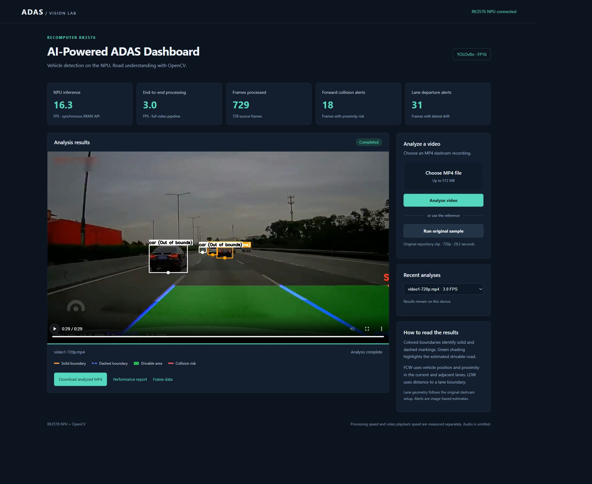
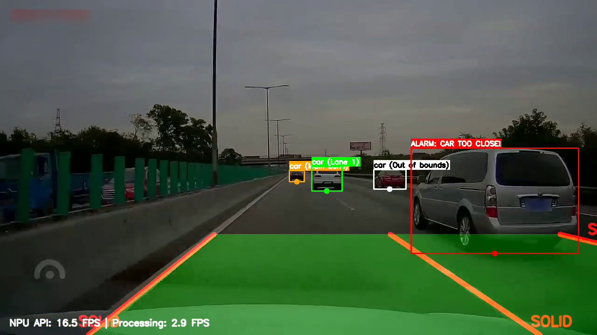
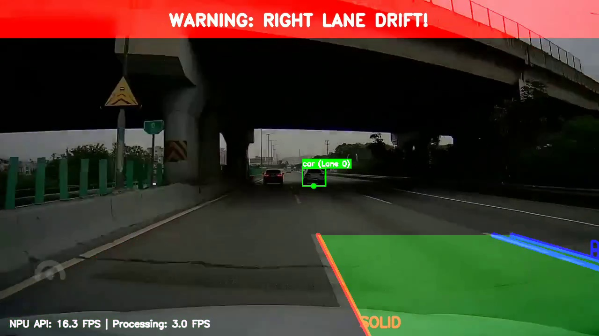

# AI-Powered ADAS Dashboard on reComputer RK3576

A working, local FastAPI dashboard with **real YOLOv8n vehicle inference on the RK3576 NPU** and the original project's OpenCV lane pipeline. Upload an MP4, watch processing previews, play/download the annotated H.264 MP4, and inspect measured NPU and end-to-end FPS. No retraining, simulated detections, or CPU fallback is used by the dashboard.



## Quick start on the verified board

The deployed project is `/home/seeed/rk3576-adas-dashboard`. Open **http://192.168.3.120:8092** while the server is running.

```bash
cd /home/seeed/rk3576-adas-dashboard
export ADAS_REUSE_DEPS=/home/seeed/rk3576-tennis-line-calling/.deps
bash run_board.sh
```

`run_board.sh` defaults to the existing Python environment at `/home/seeed/rockchip-yolo11-quant-benchmark/.venv/bin/python`. Override with `ADAS_PYTHON=/path/to/python`. `ADAS_HOST`, `ADAS_PORT`, and `ADAS_MODEL` are optional environment overrides. Run **one server process / one worker** per project; the server serializes NPU jobs and returns HTTP 409 while busy. Do not run the CLI validator concurrently with dashboard analysis when benchmarking.

The English UI provides:

- MP4 upload (maximum 512 MB) and an original-sample button.
- Real annotated JPEG previews while the video is processed.
- Separate cumulative NPU API FPS and end-to-end processing FPS.
- FCW and LDW frame counts, processing progress, and persistent completed results.
- Browser-compatible H.264 MP4 playback, seek/range requests, MP4 download, JSON performance report, and per-frame JSONL trace.

The source video's timeline is retained at 25 FPS. Playback at 25 FPS does **not** mean inference runs at 25 FPS. Audio is omitted. Uploaded videos and outputs remain under `outputs/<job-id>/`; no automatic deletion is performed.

## What is reused

Upstream: [Kiya-rb/vision-based-adas-dashboard](https://github.com/Kiya-rb/vision-based-adas-dashboard), pinned to `58e6f31f5e4cc8c7b1c838920d9da454e2c11627` (MIT).

The full implementation is in `notebook/FinalProject.ipynb`; upstream `src/project.py` contains unfinished rendering code. `tools/extract_upstream.py` extracts the Notebook's function source into `adas/upstream_lanes.py` without executing notebook setup, plotting, weight downloads, or GUI windows.

| Feature | Implementation |
| --- | --- |
| Vehicles | Original pretrained COCO YOLOv8n, classes 2/3/5/7: car, motorcycle, bus, truck; confidence 0.30 |
| Road enhancement | OpenCV CLAHE |
| Lane features | Bilateral smoothing, HLS color thresholds, Sobel gradients, original proportional ROI and vehicle blackout |
| Lane fitting | Original Hough transform, DBSCAN, spatial conflict rejection, temporal EMA and classification voting |
| Solid/dashed | Original video paint-fill rule: fill ratio > 0.85 and longest continuous segment ratio > 0.55 |
| Drivable road | Original adjacent-boundary polygons with asphalt-color validation |
| LDW | Original lane-boundary proximity to camera center, margin 150 pixels |
| FCW | Original bottom-center lane assignment; vehicle bottom beyond 75% of image height in the host or adjacent lane |

The raw pretrained checkpoint is `models/yolov8n.pt`. As upstream explains, the weights are **not committed in the upstream repository**; YOLO downloads them on first use. This reproduction reuses the existing local official COCO YOLOv8n checkpoint, SHA-256 `f59b3d833e2ff32e194b5bb8e08d211dc7c5bdf144b90d2c8412c47ccfc83b36`. No training command is run.

The exact original input is `upstream/data/roads/video1-720p.mp4`: 1280×720, 25 FPS, 729 frames (29.16 seconds). It is the raw test input, not the upstream pre-annotated demonstration. `tools/verify_sources.py` verifies all five retained upstream source/input files against their Git blob hashes and writes `upstream/manifest.json`.

Explicit integration changes:

1. Run vehicle inference once per frame and reuse its real boxes in both original vehicle blackout and traffic analysis. Replace Torch-box conversions with NumPy; board inference does not import Torch or Ultralytics.
2. Correct the original CLAHE RGB/BGR mismatch: video frames and subsequent masks are BGR.
3. Correct a Notebook indexing bug: DBSCAN indexes filtered Hough features, so paint-fill segments must come from the same filtered records, rather than the unfiltered Hough array.
4. Add headless H.264 encoding, telemetry, job handling, and the FastAPI UI. Keep the original lane thresholds and warning rules.

`outputs/rk3576-original/` records the full-video baseline before the two lane fixes; `outputs/rk3576-final/` records the corrected implementation. Detection results are never manufactured to force an alert.

## Model conversion: pretrained PT → ONNX → RKNN

### 1. Export on the PC

Use a separate export environment; this step needs PyTorch and Ultralytics, the board does not.

```bash
python -m venv .venv-export
# Activate the environment for your operating system.
python -m pip install -r requirements-export.txt
python tools/verify_sources.py --fetch
python tools/extract_upstream.py
python tools/export_model.py
```

The included pretrained PT checkpoint and compiled RKNN let you skip export/conversion for normal board use. The executed upstream Notebook and intermediate ONNX are omitted from Git. Source verification with `--fetch` downloads the pinned Notebook when re-extraction is needed; the export step generates ONNX locally.

Export keeps pretrained weights unchanged and uses the [Rockchip YOLOv8 raw-head contract](https://github.com/airockchip/rknn_model_zoo/tree/main/examples/yolov8). It exports static batch 1, opset 12, input `[1,3,640,640]`, and three outputs per scale (strides 8, 16, 32):

- Box distribution logits `[1,64,H,W]`.
- COCO class probabilities `[1,80,H,W]`.
- Summed class score `[1,1,H,W]` (available for the standard contract; not needed by this decoder).

DFL decoding and class-aware NMS remain on the CPU. This is still NPU neural-network inference; color conversion, resize, lane extraction, drawing, and encoding are CPU operations. `outputs/pytorch-onnx-comparison.json` checks that the exported head reproduces pretrained PyTorch detections on seven original-video frames.

### 2. Compile with existing Linux RKNN Toolkit2

The verified PC uses Ubuntu 22.04 WSL and `/home/seeed/.venvs/rknn-toolkit2-2.3.2/bin/python`.

```bash
cd /mnt/d/rk3576/Projects/rk3576-adas-dashboard
mkdir -p outputs
/home/seeed/.venvs/rknn-toolkit2-2.3.2/bin/python tools/convert_model.py \
  > outputs/convert-fp16.log 2>&1
```

On another Linux PC, install [RKNN Toolkit2 2.3.2](https://github.com/airockchip/rknn-toolkit2) in a compatible Python environment, then run the same script. The conversion explicitly sets `target_platform='rk3576'`, mean `[0,0,0]`, standard deviation `[255,255,255]`, and `do_quantization=False`.

The output is `models/yolov8n_rk3576_fp16.rknn`. No quantization calibration or retraining is needed. Source ONNX/model hashes, compiler version and input contract are written next to the RKNN. All RKNN return codes are checked.

Conversion timing was measured again on the same ONNX with Toolkit2 2.3.2 in the existing WSL environment: **1.58 seconds** from RKNN object initialization through export, including **1.20 seconds for `build()`**, 0.18 seconds for ONNX loading and 0.11 seconds for RKNN export. Python imports and WSL/process startup are outside this API timer; the complete shell invocation took about **8 seconds**. The original conversion command also took about 7.9 seconds, but did not record individual stage timings. This is ONNX-to-RKNN conversion time, not training or PT-to-ONNX export time. The repeat measurement writes a separate temporary model and does not replace the validated deployed model. See [conversion timings](docs/results/conversion-timing.json).

### 3. Input/output contract on the board

- Letterbox to 640×640, padding 114, aspect ratio preserved.
- OpenCV BGR → RGB; pass uint8 NHWC `[1,640,640,3]` to RKNN Lite2.
- RKNN performs `/255` using its embedded preprocessing. Do not divide the board uint8 input again.
- ONNX reference uses float32 NCHW RGB divided by 255.
- Decode DFL distributions, apply class-aware NMS at IoU 0.70, unpad/unscale and clip to the original frame.
- Five warmup calls precede timed video processing. Runtime uses `NPU_CORE_AUTO`.

## Board environment and installation

Verified hardware/software: reComputer RK3576 devkit, Debian 12 aarch64, kernel `6.1.115-vendor-seeed-rk3576`, Lite2 2.3.2, runtime 2.3.0, RKNPU driver 0.9.8, Python 3.11, OpenCV 4.11.0, NumPy 1.26.4, scikit-learn 1.8.0, imageio-ffmpeg 0.6.0. FastAPI 0.121.3, Uvicorn 0.38.0 and python-multipart 0.0.20 are isolated under this project's `.deps`. Existing NPU/OpenCV/NumPy and previous project dependencies were reused without replacing their environments.

For a fresh RK3576 installation:

```bash
python3 -m venv --system-site-packages .venv
.venv/bin/python -m pip install -r requirements.txt
# Install the official CPython/aarch64 RKNN Lite2 2.3.2 wheel appropriate to the board.
.venv/bin/python -m pip install /path/to/rknn_toolkit_lite2-2.3.2-*-aarch64.whl
ADAS_PYTHON="$PWD/.venv/bin/python" bash run_board.sh
```

Use the wheel distributed by Rockchip, not a similarly named unrelated package. The bundled `imageio-ffmpeg` binary provides H.264 encoding; no system FFmpeg replacement is necessary. The static-model dynamic-range warning emitted by this runtime is benign; a failed load/init/inference is an actual error and is surfaced.

This is a single-operator trusted-LAN demonstration. For operation outside a trusted LAN, configure authentication and an appropriate reverse proxy. The upload limit is per MP4; leave storage for decoded processing and output. The board retains existing unrelated projects.

## Run and validate without the UI

```bash
export PYTHONPATH="$PWD/.deps:/home/seeed/rk3576-tennis-line-calling/.deps"
PYTHON=/home/seeed/rockchip-yolo11-quant-benchmark/.venv/bin/python
"$PYTHON" tools/validate_detector.py --backend rknn \
  --model models/yolov8n_rk3576_fp16.rknn --output outputs/detector-validation
"$PYTHON" tools/run_video.py --output outputs/rk3576-final
```

For an ONNX/PyTorch reference on the PC:

```bash
python tools/validate_detector.py --backend pytorch --model models/yolov8n.pt --output outputs/pytorch-reference
python tools/validate_detector.py --backend onnx --model models/yolov8n_raw.onnx --output outputs/onnx-reference
python tools/compare_detections.py outputs/pytorch-reference/detections.json \
  outputs/onnx-reference/detections.json --output outputs/pytorch-onnx-comparison.json
python tools/compare_detections.py outputs/onnx-reference/detections.json \
  outputs/detector-validation/detections.json --output outputs/onnx-rknn-comparison.json
```

The seven frame indices are 0, 125, 250, 375, 500, 625 and 728. Each contains real inference, not annotated-video scraping. Matching is one-to-one and class-aware; the comparison fails on count differences or any matched IoU below 0.90. Observed: 25 detections in each backend, PyTorch↔ONNX minimum IoU 0.9980; ONNX↔RKNN minimum IoU 0.9599, maximum confidence difference 0.0298.

With the server running, validate upload → actual full-video NPU processing → preview → download:

```bash
"$PYTHON" tools/smoke_web.py --url http://127.0.0.1:8092
```

This uses the unchanged original MP4, verifies all 729 frames, checks live JPEGs, rejects invalid uploads/concurrent jobs, and checks downloaded MP4 byte ranges, report and JSONL trace. See `outputs/web-validation.json`.

The completed HTTP validation passed all 13 checks, including 125 real JPEG preview requests. Its uploaded 729-frame run measured **16.85 NPU FPS / 2.88 end-to-end FPS** (253.19 seconds). The original-upload SHA-256 matched the pinned input. The downloaded H.264 MP4 was 6,961,527 bytes; its hash and all timings are retained in the validation report.

## FPS measurement

**NPU FPS** = processed frames / sum of wall-clock durations around synchronous `RKNNLite.inference`. This includes RKNN API input/output transfer and runtime overhead; it is not a hardware cycle-counter claim. It excludes letterbox, DFL/NMS, lanes and rendering. No timed inference frames are skipped. Standalone detector validation also records 50 raw API timings separately.

**End-to-end processing FPS** = processed frames / wall time for the video processing loop and H.264 encoder finalization. It includes decoding after the initial metadata/frame probe, preprocessing, inference, postprocessing, lane extraction, warnings, drawing, trace writing and encoding. Model initialization, five warmups, initial frame probe, network upload/download and browser playback are outside the timed interval. Preview callbacks are included for Web jobs. Live/overlay values are cumulative during processing; the final report includes encoder finalization.

The original-lane baseline measured 729/729 frames in 240.36 seconds: **16.13 NPU FPS / 3.03 end-to-end FPS**, 19 FCW frames and 29 LDW frames. These are frame counts, not unique incidents or accuracy scores. The corrected full-video run measured **16.33 NPU FPS / 3.05 end-to-end FPS** in 239.21 seconds, with 18 FCW frames and 31 LDW frames. Web-upload measurements are recorded separately in `outputs/web-validation.json`.

`tools/audit_video.py outputs/rk3576-final` decodes every output frame and verifies timestamps/frame counts, aggregate warnings and the NPU FPS formula against the trace. The actual first FCW screenshot is frame 85 and first LDW screenshot is frame 308 (zero-based). Both solid and dashed classifications occur in the recorded trace. `outputs/environment.json` records board dependency versions and the deployed model hash.





## Artifacts and structure

```text
adas/detector.py             Real RKNN/ONNX preprocessing, decoding and adapter
adas/upstream_lanes.py       Generated original lane/warning functions + documented fixes
adas/pipeline.py             Video pipeline, encoding, actual timing, trace
server.py                    FastAPI, bounded uploads, serialized NPU jobs, artifacts
web/                        English HTML/CSS/JavaScript UI
models/                     Original PT, raw ONNX, RK3576 FP16 RKNN, manifests
tools/                      Export, conversion, extraction, source verification and real validation
upstream/                   Original code, raw MP4, license, manifest; Notebook fetched on demand
docs/                       Selected real screenshots, validation summaries and conversion timing
outputs/                    Real conversion logs, comparison evidence, board videos and traces
run_board.sh                Existing-board environment launcher
```

`tools/board_remote.py` is a development SSH helper. It reads `BOARD_SSH_PASSWORD` or the SSH agent; no credentials are shipped in code. It is not needed to run the dashboard.

Git includes source, the original sample MP4, pretrained `.pt`, validated `.rknn` and model metadata. Intermediate ONNX, executed Notebook outputs, environments, caches, logs, deployment archives and generated inference videos/traces remain local and are ignored. Selected compact validation evidence is retained in `docs/results/`.

## Limits

This preserves the original linear, camera-dependent lane model and image-position warning heuristics. Sharp curves, shadows, unusual camera positions and different resolutions can reduce reliability; adjust the original ROI/pixel thresholds for a new camera. Solid/dashed labels are classical paint-fill estimates, not neural predictions. FCW is a proximity hint, not a calibrated distance or time-to-collision measurement. LDW uses camera-center geometry and cannot infer driver intent. No accuracy claim or safety certification is made from this single clip.

The sample verifies both alert paths on real video. It is an offline demonstration; the measured full-pipeline rate is below the source playback rate.

## Sources and licenses

- [Original ADAS project](https://github.com/Kiya-rb/vision-based-adas-dashboard): MIT; original notice retained in `upstream/LICENSE`. The report/media retain their upstream terms; raw test footage is retained as its reproducibility input.
- [Ultralytics](https://github.com/ultralytics/ultralytics): pretrained YOLOv8n and export/reference dependencies; review Ultralytics AGPL-3.0/enterprise terms for redistribution and deployment.
- [Rockchip RKNN Toolkit2](https://github.com/airockchip/rknn-toolkit2) and [Model Zoo YOLOv8](https://github.com/airockchip/rknn_model_zoo/tree/main/examples/yolov8): toolchain and raw-head layout reference.
- [FastAPI upload documentation](https://fastapi.tiangolo.com/tutorial/request-files/): MP4 upload interface.
